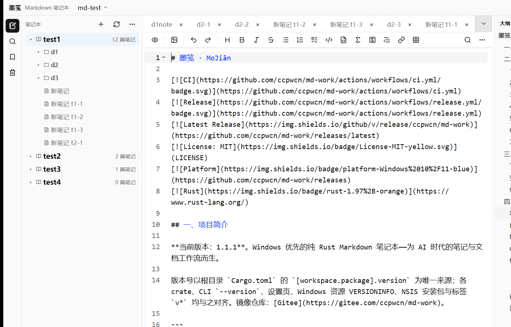
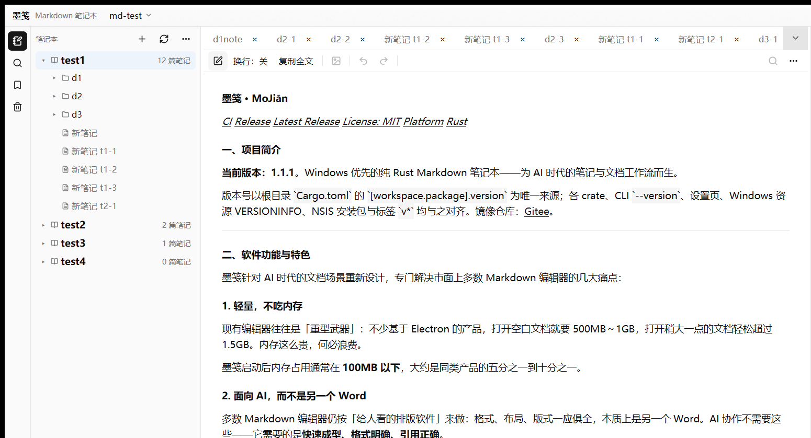

# 墨笺 · MoJiān

[](https://github.com/ccpwcn/md-work/actions/workflows/ci.yml)
[](https://github.com/ccpwcn/md-work/actions/workflows/release.yml)
[](https://github.com/ccpwcn/md-work/releases/latest)
[](LICENSE)
[](https://github.com/ccpwcn/md-work/releases)
[](https://www.rust-lang.org/)

## 一、项目简介

**当前版本：1.2.7**。Windows 优先的纯 Rust Markdown 笔记本——为 AI 时代的笔记与文档工作流而生。

版本号以根目录 `Cargo.toml` 的 `[workspace.package].version` 为唯一来源；各 crate、CLI `--version`、设置页、Windows 资源 VERSIONINFO、NSIS 安装包与标签 `v*` 均与之对齐。镜像仓库：[Gitee](https://gitee.com/ccpwcn/md-work)。

---

## 二、软件功能与特色

墨笺针对 AI 时代的文档场景重新设计，专门解决市面上多数 Markdown 编辑器的几大痛点：

### 1. 轻量，不吃内存

现有编辑器往往是「重型武器」：不少基于 Electron 的产品，打开空白文档就要 500MB～1GB，打开稍大一点的文档轻松超过 1.5GB。内存这么贵，何必浪费。

墨笺启动后内存占用通常在 **100MB 以下**，大约是同类产品的五分之一到十分之一。

### 2. 面向 AI，而不是另一个 Word

多数 Markdown 编辑器仍按「给人看的排版软件」来做：格式、布局、版式一应俱全，本质上是另一个 Word。AI 协作不需要这些——它需要的是**快速成型、格式明确、引用正确**。

墨笺按这个目标裁剪交互与能力：写得快、结构清、给 AI 读得懂、归档也方便。

### 3. 开源免费，基础功能永久免费

本软件开源、基础功能永久免费。日后可能增加账号与付费增强能力，但核心编辑、预览、导入导出与本地工作流不会变成付费墙。

### 4. 自己修那些「多年未修」的旧疾

资源管理器双击崩溃、意外空行、emoji 失色……这类问题在一些老牌软件里挂了很久。指望别人不如自己动手，墨笺在设计上刻意避开这些坑。

### 5. 内置与 AI 打交道的能力

笔记可以交给 AI 阅读与处理；AI 产出的文档也可以直接放回墨笺归档。通过内置 MCP（stdio / 本机 HTTP）把工作区、笔记本与笔记接入 AI 工具链。

### 6. 常规能力齐全

编辑、格式、排版布局、大纲、搜索、书签、导入导出、整本打包、崩溃恢复……该有的都有，不做花架子，做实用的本地笔记本。

### 7. 大文档与导出也很快

实测约 **50MB** 的大文档可在 **2 秒内**打开（同文档在多数现有软件上很难在 5 秒内打开）。同文档导出 PDF，市面常见软件大约 15～30 秒，墨笺大约 **5 秒**。

---

用墨笺打开本 README，就是最好的说明：

编辑模式：



预览模式：



---

## 三、下载 / 安装 / 使用

### 下载

到 [GitHub Releases](https://github.com/ccpwcn/md-work/releases/latest)（或 [Gitee Releases](https://gitee.com/ccpwcn/md-work/releases)）下载最新版：

| 产物 | 说明 |
| --- | --- |
| `md-work-1.2.7-setup.exe` | NSIS 安装包（推荐） |
| `md-work-1.2.7-win64.zip` | 便携版，解压即用 |

### 安装

- **安装包**：双击 `md-work-*-setup.exe`，按提示选择工作区（默认 `我的文档\md-work`）。安装到当前用户目录，**不需要管理员权限**，不写 HKLM，也不会静默抢走 `.md` 的默认打开方式。
- **静默安装**：`md-work-1.2.7-setup.exe /S`（不弹页面，使用默认工作区）。
- **便携版**：解压 zip 后直接运行 `md-work.exe`。

安装目录（按用户）：`%LOCALAPPDATA%\Programs\md-work`。

### 使用入门

1. 启动后选择或确认工作区（磁盘上的普通文件夹）。
2. 在工作区里新建笔记本与笔记，开始写 Markdown。
3. `Ctrl+T` 切换编辑 / 预览；`Ctrl+Shift+P` 打开命令面板。
4. 需要给 AI 用时：设置 → MCP，生成令牌并启用本机 HTTP，再把地址与令牌配到客户端。

常用快捷键：

| 快捷键 | 功能 |
| --- | --- |
| `Ctrl+S` | 保存当前笔记 |
| `Ctrl+N` | 新建笔记 |
| `Ctrl+F` / `Ctrl+H` | 查找 / 替换 |
| `Ctrl+T` | 切换编辑 / 预览 |
| `Ctrl+Shift+P` | 命令面板 |
| `Ctrl+B` / `Ctrl+I` | 加粗 / 斜体 |
| `Ctrl+K` | 插入链接 |

更细的功能说明、配置路径、MCP / CLI 与构建方式见下方「技术实现与实施方案」。

---

## 四、技术实现与实施方案

界面由 GPUI + gpui-component 驱动，渲染与导出基于 comrak 与 Typst，MCP 服务基于 rmcp。笔记以普通文件夹保存，不锁定数据格式。

参考 VNote 的使用习惯，但针对其常见顽疾做了修正：资源管理器双击 `.md` 崩溃、PDF 导出质量差、缺少书签与整本打包、MCP 能力不完整。

### 功能一览

- **工作区**：工作区是磁盘上的一个普通文件夹，里面可以建多个笔记本。标题栏左上角的下拉框可随时切换工作区、选择任意文件夹（也可以导入之前导出的笔记本 zip）；下次启动自动打开上次的工作区、笔记本与笔记。可在「设置 → 工作区」给工作区起别名，磁盘上的文件夹名保持不变。切换工作区不会移动或删除文件。
- **笔记本**：普通文件夹即笔记本，支持多笔记本、树形目录、新建文件夹/笔记、重命名、移动、回收站。
- **编辑器**：Markdown 语法高亮、软换行、查找/替换（`Ctrl+F` / `Ctrl+H`）、预览（`Ctrl+T`）、大纲、字数/词数统计、选区统计。
- **预览代码块**：按语言做语法高亮，可逐块复制；长行可切换换行/横向滚动。
- **外部文件**：可直接打开工作区外的 `.md`，在标签栏一键“存入笔记本”（重名自动加序号，原文件不变）。
- **搜索**：跨笔记全文搜索，可选区分大小写、正则、按文件名；结果跳转到对应行。
- **书签**：为任意笔记或标题添加书签并快速跳转。
- **命令面板**：`Ctrl+Shift+P` 模糊检索全部命令。
- **面板**：笔记/大纲/搜索/书签/回收站五个面板可分别停靠左侧或右侧，也可横向或纵向排列；拖动分隔条调整宽度，双击恢复默认，宽度随配置保存。
- **导出**：Typst 渲染 PDF/PNG，支持页边距、字号、行高、目录深度、图片宽度、页码格式、两端对齐、表格宽度（按内容或满行）。
- **整本打包**：导出/导入笔记本 `.zip`（含导入预览、冲突策略），导入时校验路径逃逸、绝对路径、符号链接与体积上限。
- **编码与换行**：自动识别 UTF-8/GBK 等编码与 CRLF/LF，按原编码保存，可另存为指定编码。
- **崩溃恢复**：编辑中途异常退出时，下次启动可从快照恢复未保存内容；保存后自动清理快照。
- **崩溃上报**：崩溃日志默认只保存在本地；在运行配置中填入 Gitee 令牌后，启动时若网络可用且有历史崩溃记录，会自动在 Gitee 仓库创建 Issue 并附上崩溃日志（不含笔记内容）。令牌也可用环境变量 `MDWORK_GITEE_TOKEN` 提供，上传失败不影响启动。
- **图片**：本地 `assets/` 图床（可配置通用 HTTP / PicGo 兼容接口），图片写入限制在笔记本 `assets/` 内。
- **MCP**：stdio 与 Streamable HTTP（仅 `127.0.0.1`），默认拒绝（无令牌返回 401），DPAPI 加密令牌，按笔记本/笔记的 ACL、glob 允许/拒绝，审计 JSONL 不记录笔记正文。
- **单实例**：二次启动会把文件路径转发给已运行实例；不静默修改 Windows `.md` 默认应用。
- **通知中心**：标题栏铃铛显示未读数，普通消息、警告与错误按主题色区分，可全部已读或清空。

### 目录与配置

| 内容 | 位置 |
| --- | --- |
| 核心配置（只读语义） | `%LOCALAPPDATA%\md-work\config\core.toml` |
| 运行配置（设置项、面板停靠、上次打开） | `%LOCALAPPDATA%\md-work\config\runtime.toml` |
| 主题配置（皮肤、字体） | `%LOCALAPPDATA%\md-work\config\theme.toml` |
| 日志、MCP 令牌、恢复快照、崩溃记录 | `%LOCALAPPDATA%\md-work\` |
| 工作区元数据 | `<工作区>\.mdwork\workspace.toml` |
| 笔记本元数据 | `<笔记本>\.mdwork\notebook.toml`、`bookmarks.toml`、`encoding.toml` |
| 默认工作区 | `%USERPROFILE%\Documents\md-work` |
| 安装目录（按用户） | `%LOCALAPPDATA%\Programs\md-work` |

三份配置都是带注释的 TOML，可以直接编辑。`core.toml` 顶部会标明「此配置不可修改，否则可能导致软件运行异常」；三份文件全部缺失时会以最小默认值启动并重新生成。某个键写错时，程序会提示具体文件与键名，非核心配置的错误不会中断启动。

安装包只写 HKCU 与当前用户目录，不申请管理员权限，不修改 HKLM，也不会静默更改 `.md` 文件关联。

### MCP

1. 打开 设置 → MCP，生成令牌并启用 HTTP 服务（默认端口 `11026`）。
2. 客户端连接 `http://127.0.0.1:11026/mcp`，使用 `Authorization: Bearer <令牌>`。
3. 无令牌或令牌错误返回 401；超出 ACL 的笔记本/笔记返回 403；GUI 中有未保存修改的笔记默认拒写。

也可以用 stdio：

```powershell
md-work-cli mcp serve --stdio
```

### CLI

```powershell
# 列出工作区内的笔记本
md-work-cli notebook list --json

# 搜索（支持正则、区分大小写）
md-work-cli search "渲染" --regex --limit 50

# 导出整本笔记本
md-work-cli notebook export "我的笔记本" -o notes.zip

# 导入并预演冲突
md-work-cli notebook import notes.zip --mode merge --policy keep-both --dry-run
```

`md-work-cli export --request <json>` 供 GUI 与外部工具调用 Typst 导出。

### 构建

要求：Windows 10/11 x64、Rust 1.97+（见 `rust-toolchain.toml`）、Visual Studio 2022 C++ 工具链。

```powershell
$env:CARGO_HOME = "E:/dependencies/cargo_caches"   # 本机缓存位置，可按需省略
cargo build --workspace
cargo test --workspace
```

升版本号请用脚本（会同步 README / NSIS 回退值 / 验收清单，并刷新 `Cargo.lock`）：

```powershell
.\scripts\bump-version.ps1 1.2.0   # 指定目标版本（示例）
.\scripts\bump-version.ps1 -Patch  # 修订号 +1
.\scripts\bump-version.ps1 -Minor  # 次版本 +1
.\scripts\bump-version.ps1 -Major  # 主版本 +1
```

脚本不负责提交或打标签；发版流程见 [doc/ci.md](doc/ci.md)。

#### 图标与打包

本机功能测得差不多、准备验证「安装包 → 安装 → 使用」时，一键打安装包：

```powershell
.\scripts\build-installer.ps1            # 含 cargo test + release + NSIS
.\scripts\build-installer.ps1 -SkipTests # 开发态已测过可跳过测试
```

本机 NSIS 默认找 `E:\apps\nsis`（也可用 `-NsisHome` / 环境变量 `NSIS_HOME`）。产物在 `dist\md-work-<version>-setup.exe`。

也可分步调用 xtask：

```powershell
cargo run -p xtask -- icon        # 由 SVG 生成软件图标和安装包图标
cargo run -p xtask -- package     # release 构建 → dist/md-work-1.2.7-win64/ 与 .zip
cargo run -p xtask -- installer   # 调用 makensis 生成 dist/md-work-1.2.7-setup.exe
```

`installer` 需要 [NSIS 3](https://nsis.sourceforge.io/)（`makensis` 在 PATH、`NSIS_HOME`、`E:\apps\nsis` 或默认 Program Files 目录）。安装脚本位于 `packaging/nsis/md-work.nsi`，按用户安装、HKCU 卸载信息、卸载时保留笔记与设置。安装程序包含「选择工作区」页面（默认 `我的文档\md-work`），首次安装时把所选文件夹写入 `HKCU\Software\md-work\WorkspaceRoot`；应用只在 `config\runtime.toml`（以及旧版 `config.json`）尚无工作区时采用该值，随后写回完整配置，升级不会覆盖现有设置。支持 `/S` 静默安装（不弹页面，直接使用默认工作区）。

**随包官方文档**：`xtask package` 会把 `doc/changelog/v<当前版本>.md` 复制为 `changelog.md`、把 `doc/mcp.md` 复制为 `mcp.md`，两者都进入便携目录、zip 和 NSIS 安装包的 exe 同目录（安装版还设置了只读属性，zip 条目也带只读位）。这两份正文同时在编译期嵌入 GUI 可执行文件：新版本在本机首次启动时自动以只读预览打开 `changelog.md`，用户关闭该标签后版本写入 `config\runtime.toml` 的 `shown_changelog_version`，之后不再自动打开；设置 → MCP 的「使用详细说明」按钮会关闭设置面板并以只读预览打开 `mcp.md`。运行时按 SHA-256 校验磁盘副本，若被改动会弹窗提醒，并始终显示内置的权威版本；官方标签页不能切到编辑模式、不能保存，也不会写进会话。

#### 持续集成

GitHub Actions 与 Gitee Go 的流水线配置、Gitee 自建 Windows 主机组与发版步骤见 [doc/ci.md](doc/ci.md)：推送分支或 PR 自动构建并运行测试；GitHub 侧 `dev` 的推送（无论是否带 `v*` 标签）只跑测试、不发版，只有 `main` 的推送且对应标签已进入 `main` 历史时才在 `main` 分支起草并发布 Release；Gitee Go 仍由标签触发。

### 已知限制（v1 范围）

- 不含 Mermaid / PlantUML / Graphviz 图表渲染。
- 不含 AI 助手（仅保留 `AiProvider` 扩展点）。
- 不含标签、云同步、多窗口。
- 不含使用统计遥测与自动更新；崩溃上报默认关闭，仅在配置令牌后向 Gitee 提交崩溃栈。
- 预览与导出中的代码块暂不带行号（Typst 0.15 的 `raw` 不支持行号）。
- 未启用 Windows 长路径（>260 字符）支持：gpui 预编译库自带 manifest，无法再注入 `longPathAware`。

### 许可

MIT。第三方组件见 [THIRD-PARTY-NOTICES.md](THIRD-PARTY-NOTICES.md)。
